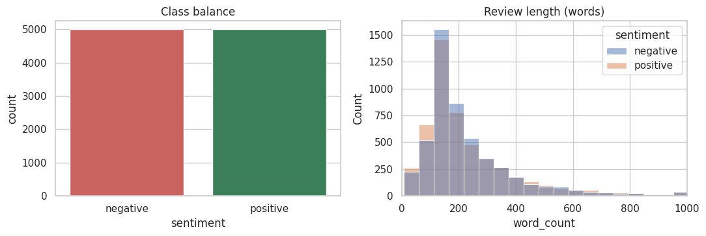
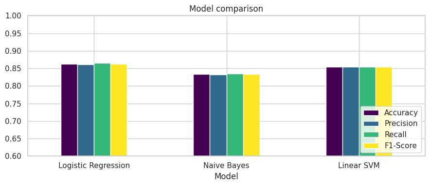
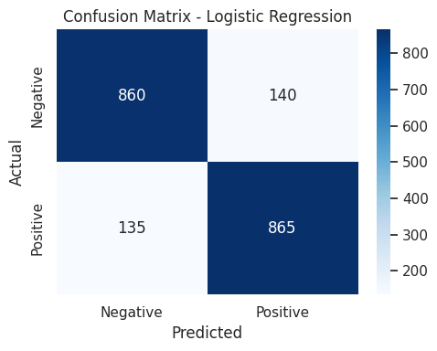
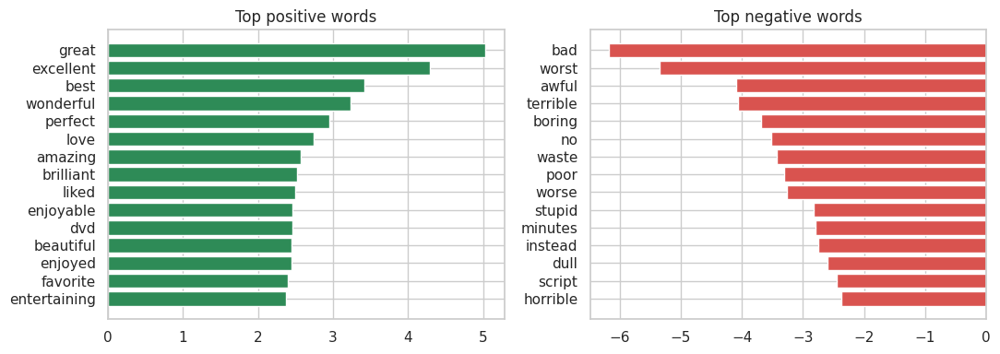

# Movie Review Sentiment Classification (ML-008)

Binary sentiment classifier (Positive / Negative) for IMDB movie reviews using **TF-IDF + classical ML**.
BCA (AI), Section B, Invertis University, Bareilly (2026-27) | Mentor: Mr. Sahil Kasaudhan | Program: Machine Learning (BCA_AI_ML_08)

## Pipeline
`Load data -> Clean text -> TF-IDF -> Train 3 models -> Evaluate -> Custom tests -> Error analysis -> Save -> Gradio demo`

## Dataset
- IMDB Large Movie Review Dataset (Maas et al., 2011), 50,000 labelled reviews.
- This project uses a **balanced 10,000-review subset** (5,000 positive + 5,000 negative), 80/20 stratified split (8,000 train / 2,000 test).
- The full dataset is not stored here (size). Download it from <https://ai.stanford.edu/~amaas/data/sentiment/> or Kaggle "IMDB Dataset of 50K Movie Reviews" and place the CSV (columns `review`, `sentiment`) in `data/raw/`.
- `data/processed/cleaned_movie_reviews_sample.csv` is a 1,000-row sample of the cleaned data.

## Preprocessing
lowercase -> remove HTML tags -> remove special characters/digits -> remove extra spaces -> tokenize -> remove stop-words.
Negation words (`not`, `no`, `nor`, `never`, `cannot`) are **kept**, because "not good" and "good" mean opposite things.

## Results (test set, 2,000 reviews)
| Model | Accuracy | Precision | Recall | F1 |
|---|---|---|---|---|
| **Logistic Regression** | **0.8625** | 0.8607 | 0.8650 | **0.8628** |
| Linear SVM | 0.8545 | 0.8549 | 0.8540 | 0.8544 |
| Naive Bayes | 0.8335 | 0.8325 | 0.8350 | 0.8337 |

Best model: Logistic Regression (confusion matrix: TN 860, FP 140, FN 135, TP 865).
Custom review test: 6 of 7 correct (it missed the negation case "Not bad at all, I actually enjoyed it.").






## Repository layout
```
data/raw/            put the downloaded IMDB csv here (git-ignored)
data/processed/      cleaned dataset sample
notebooks/           exploratory_data_analysis.ipynb  (full Colab notebook, Steps 0-12)
src/                 preprocess.py, vectorize.py, train.py, evaluate.py
figures/             graphs used in the report
models/              trained tfidf + models (.pkl)
results/             model_results.csv, custom_tests.csv, misclassified_reviews.csv
docs/                final report PDF and presentation slides
```

## How to run
```bash
pip install -r requirements.txt

# 1. clean the raw data (needs data/raw/<imdb>.csv)
python src/preprocess.py --raw data/raw/IMDB_Dataset.csv --out data/processed/cleaned_movie_reviews.csv
# 2. train the 3 models, saves models/ and results/model_results.csv
python src/train.py
# 3. evaluation figures + error analysis -> figures/, results/
python src/evaluate.py
```
Or open `notebooks/exploratory_data_analysis.ipynb` in Google Colab and run all cells.
Re-running may change the numbers by a fraction of a percent (library versions / row order).

## Load the saved model
```python
import joblib
from src.preprocess import clean_text
tfidf, model = joblib.load("models/tfidf.pkl"), joblib.load("models/best_model.pkl")
print(model.predict(tfidf.transform([clean_text("A brilliant film, I loved it")])))  # [1] = positive
```

## Limitations and future work
Sarcasm, negation ("not bad") and mixed opinions cause most errors. Ideas: lemmatization, trigrams, tuning `C`, transformer models (BERT).

## Team (ML-008)
Shreya Sharma, Utkarsh Kumar, Drasti Singhal, Deepti Gangwar, Abhisar Kumar, Manish Kumar Gautam, Pawan Kushwaha, Vanshika, Aashish Pandey, Devvrat Kushwaha, Jagat Singh, Anubhav Kumar.

| Part | Owner | Notebook steps |
|---|---|---|
| Data mining and cleaning | Member 1 | 2-4 -> `src/preprocess.py` |
| Features and models (+ Gradio demo) | Member 2 | 5-6, 12 -> `src/vectorize.py`, `src/train.py` |
| Evaluation and analysis | Member 3 | 7-10 -> `src/evaluate.py` |
| Report and slides | Member 4 | `docs/` |

## Citation
Maas, A. L., Daly, R. E., Pham, P. T., Huang, D., Ng, A. Y., & Potts, C. (2011). *Learning Word Vectors for Sentiment Analysis.* ACL.
